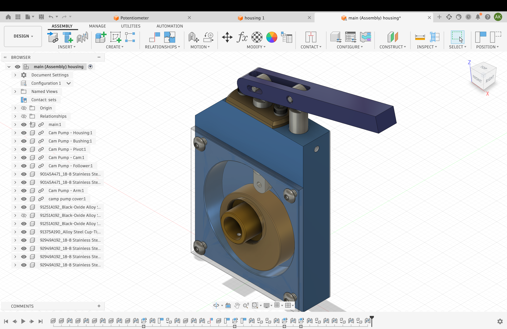

# Cam Pump

A cam-driven pump mechanism I modeled in Fusion 360 to learn how to build assemblies with moving parts.

## How it works

The cam sits inside the housing. As it turns, it pushes the follower. The follower moves the arm on top, which swings around the pivot.

## Parts

- Housing with a clear cover
- Bushing
- Cam
- Follower
- Pivot
- Arm
- Off-the-shelf McMaster-Carr hardware: stainless steel and alloy steel screws, pins, and a set screw

## What I practiced

- Putting separate parts together into one assembly
- Joints and a contact set, so the parts move the way the real ones would
- Adding standard hardware from McMaster-Carr

## Files

| File | What it is |
| --- | --- |
| `cam-pump.png` | Fusion 360 screenshot of the assembly |

## Tools

Fusion 360

<!-- Optional: export an STL from Fusion and upload it here, so people can spin the model on GitHub. Delete this note when done. -->
