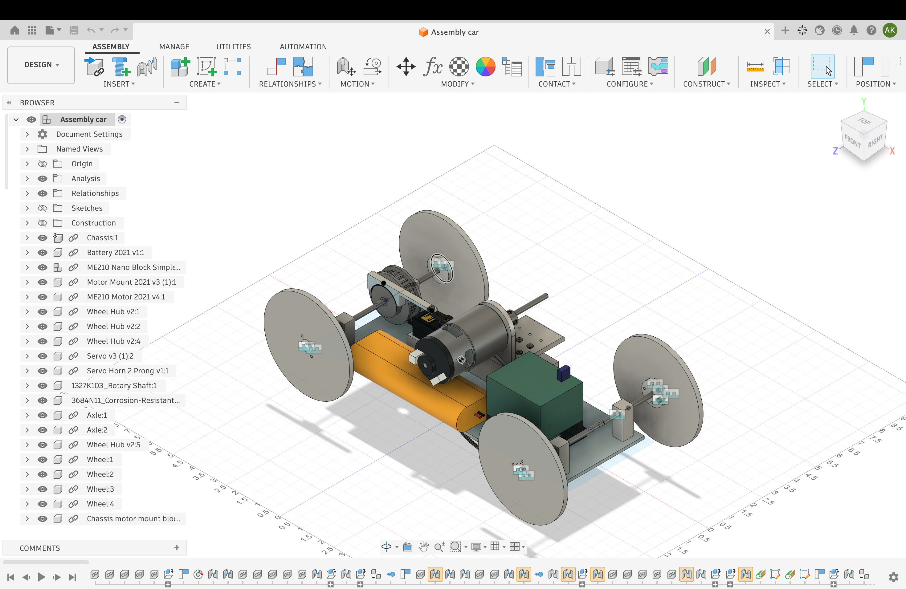

# Race Car (Team Project)

A small electric race car my team designed for the car race in our mechanical engineering class at Lafayette College. We modeled the whole car as one assembly in Fusion 360.

## What's in the assembly

- Chassis, with a block that mounts the motor
- Motor and motor mount
- Battery
- Servo with a 2-prong servo horn
- Nano block
- Four wheels on wheel hubs, with two axles
- Off-the-shelf parts from McMaster-Carr, like a rotary shaft

## My part

This was a team project.

<!-- Write what YOU did here: which parts you designed, what you built or tested. Delete this note when done. -->

## Files

| File | What it is |
| --- | --- |
| `race-car-assembly.stl` | 3D model of the full car. Click it on GitHub to spin it around. |
| `race-car-assembly.png` | Fusion 360 screenshot of the assembly |

## Tools

Fusion 360

<!-- Optional: add how the car did in the race, and one thing your team learned. Delete this note if you skip it. -->
