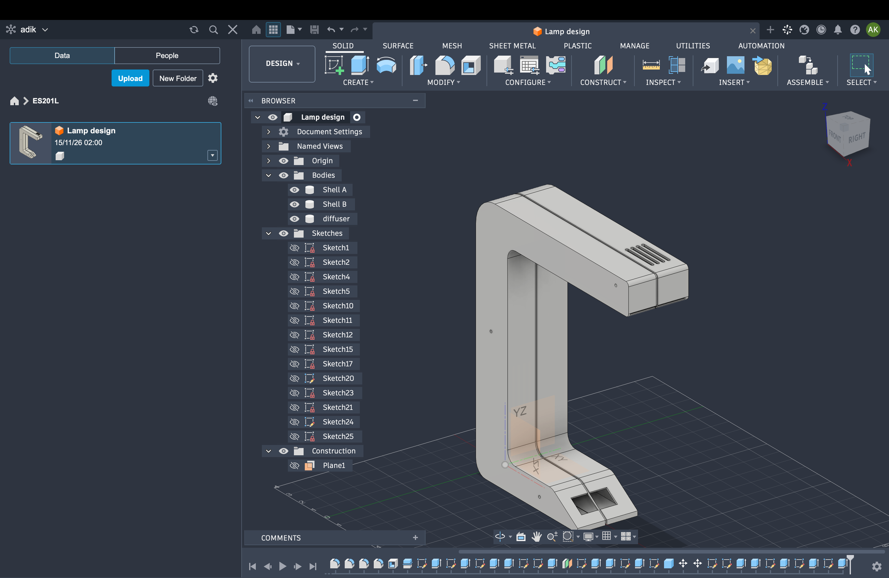

# Smart Lamp (In Progress)

A smart lamp I'm designing right now. The plan is LED strips for light, sensors, a cooler, and a control system that runs everything.

## Current design

I'm modeling the body in Fusion 360. So far it has:

- A body split into two shells (Shell A and Shell B)
- A diffuser to spread the light
- Vent slots on the top arm
- Openings in the base

## Planned

- LED strips
- Sensors
- A cooler
- A control system

## Status

Work in progress. This repo will grow as the project does: CAD, wiring, code, and photos.

## Files

| File | What it is |
| --- | --- |
| `lamp-design.png` | Fusion 360 screenshot of the current design |

## Tools

Fusion 360

<!-- Optional: add which sensors you plan to use and what they'll control. Delete this note if you skip it. -->
